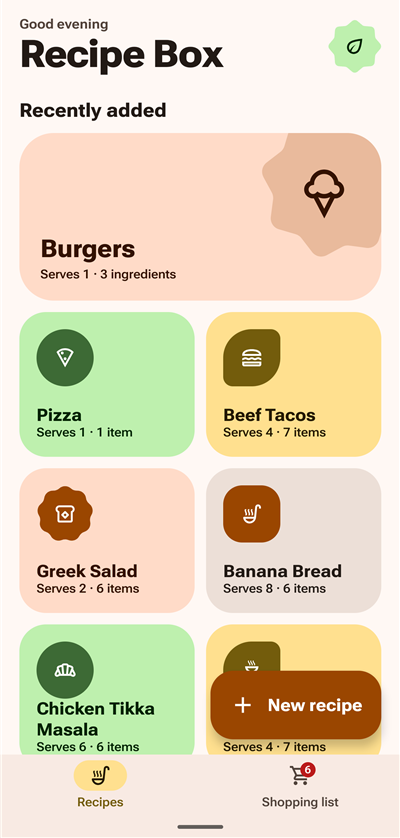
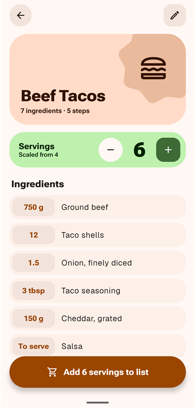
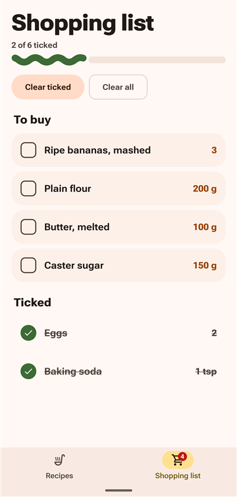
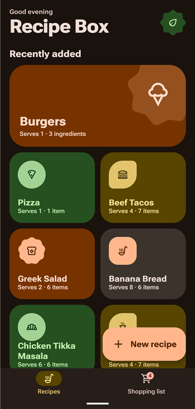
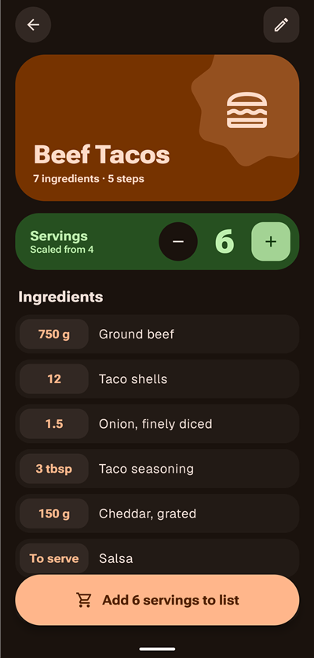
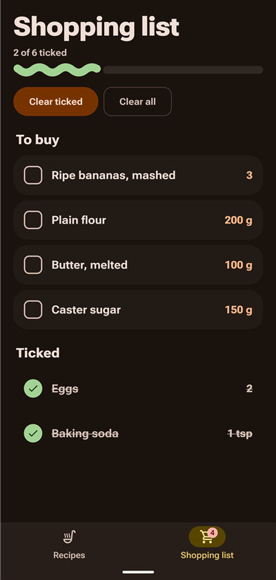

# Recipe Box

An offline Android app for saving your recipes, rescaling them to any number of servings, and turning them into one combined shopping list. Built with Jetpack Compose and Material 3 Expressive.

| Recipes | Recipe detail | Shopping list |
| :---: | :---: | :---: |
|  |  |  |
|  |  |  |

Screenshots show the tangerine fallback palette. On a device, the app uses dynamic colour from your wallpaper by default.

## Features

- **Recipes**: add, edit and delete recipes with a title, servings, ingredients (amount, unit, name) and method steps.
- **Scaling**: change the servings on a recipe and every ingredient amount updates. Amounts are rounded for display, and spoons and cups use cooking fractions (1½ tbsp). The saved recipe never changes.
- **Shopping list**: add a recipe at its chosen servings. Matching items (same name, ignoring case, and same unit) are merged, amount-less items like "salt" are added once, and items merged from several recipes show "From N recipes". Tick items off, then clear the ticked ones or the whole list.
- **Offline**: everything is stored locally in a Room database.

## Tech stack

| Piece | Used for |
| --- | --- |
| Kotlin | Language |
| Jetpack Compose + Material 3 Expressive | UI, theming, `MaterialShapes`, expressive motion |
| Room | Local SQLite storage for recipes and the shopping list |
| ViewModel + StateFlow | Per-screen state that survives rotation |
| Navigation Compose | Single-activity navigation with a bottom bar |

The app has four layers: UI (Compose screens) → ViewModels → Repository → Room. Scaling and shopping-list merging are plain Kotlin functions in `util/` with unit tests.

Min SDK 31 (Android 12), target SDK 37.

## Building

Open the project in Android Studio, or use Gradle from the command line (`gradlew.bat` on Windows):

```bash
./gradlew assembleDebug          # build a debug APK
./gradlew installDebug           # install on a connected device
./gradlew test                   # run unit tests
./gradlew lint                   # run lint
```

## Project structure

```
app/src/main/java/com/example/recipebox/
  MainActivity.kt          # Single activity; sets Compose content
  navigation/              # Nav graph and bottom navigation bar
  data/                    # Room entities, DAOs, database, repositories
  ui/recipelist/           # Recipe list (hero card + grid)
  ui/recipedetail/         # Recipe detail with servings scaler
  ui/recipeedit/           # Add / edit / delete a recipe
  ui/shoppinglist/         # Shopping list
  ui/components/           # Shared Expressive widgets
  ui/theme/                # Colour schemes, typography (Roboto Flex), shapes
  util/                    # Scaling, formatting and merge logic (pure Kotlin)
```

## Roadmap

Planned for version 2: photos, tags and search, importing recipes from websites, and cloud sync and sharing.
